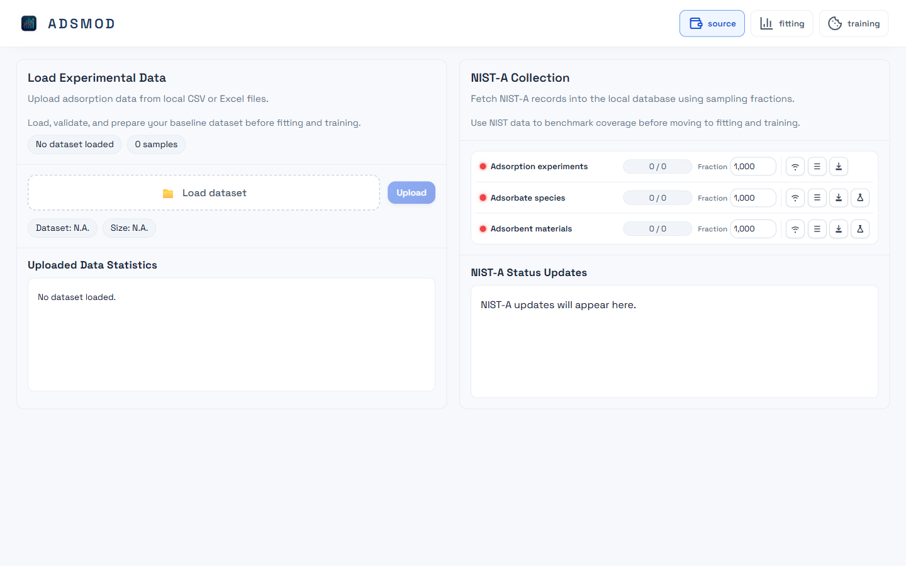
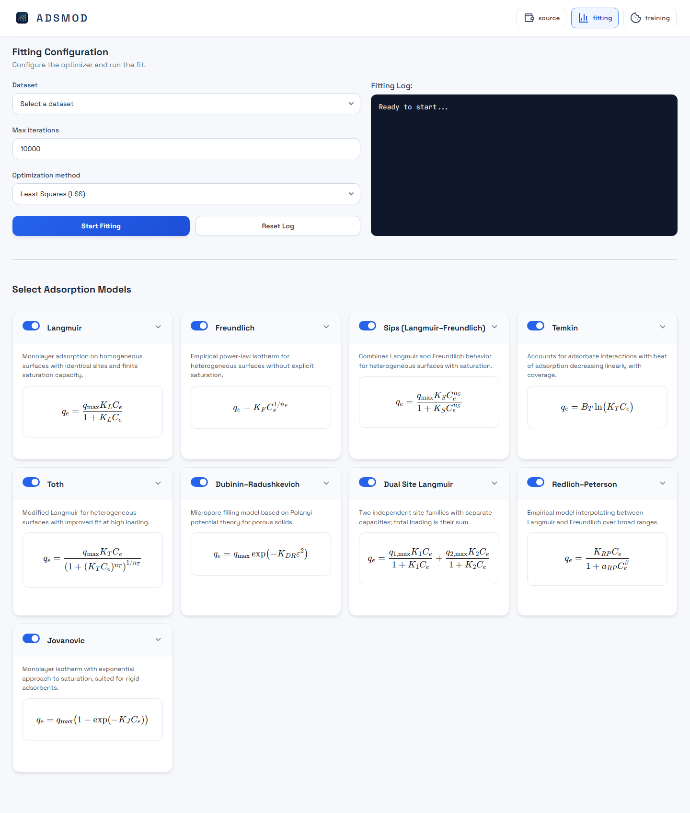
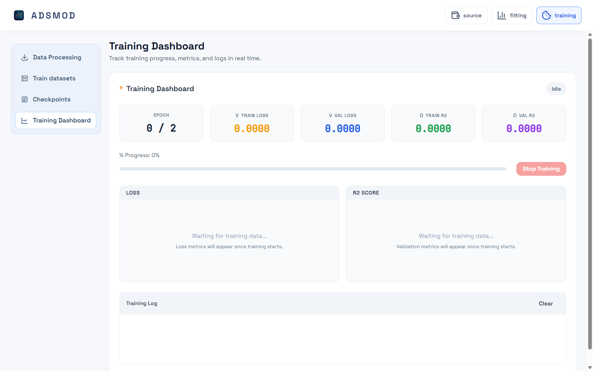
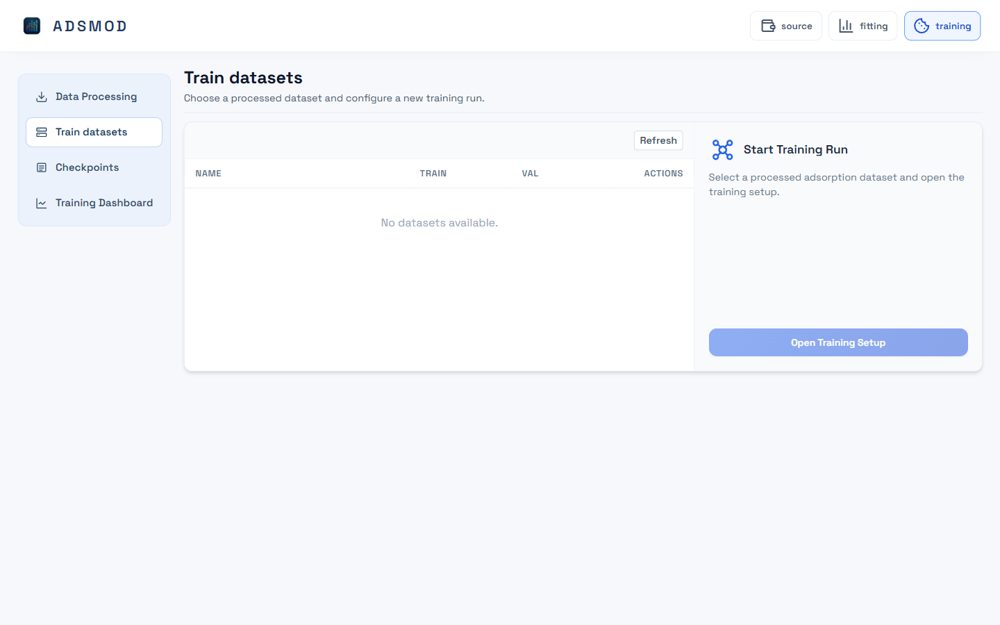
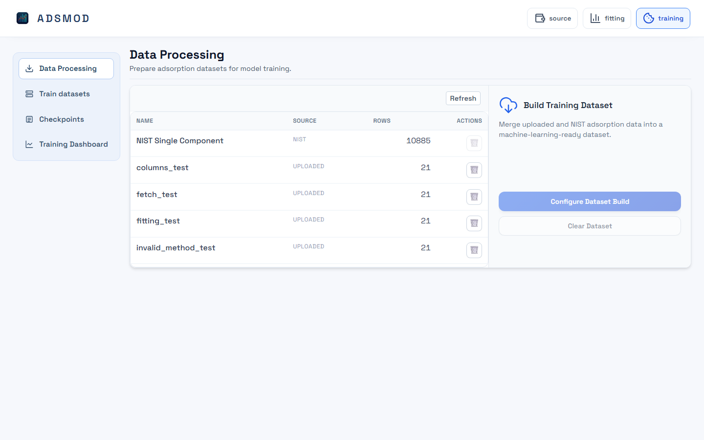
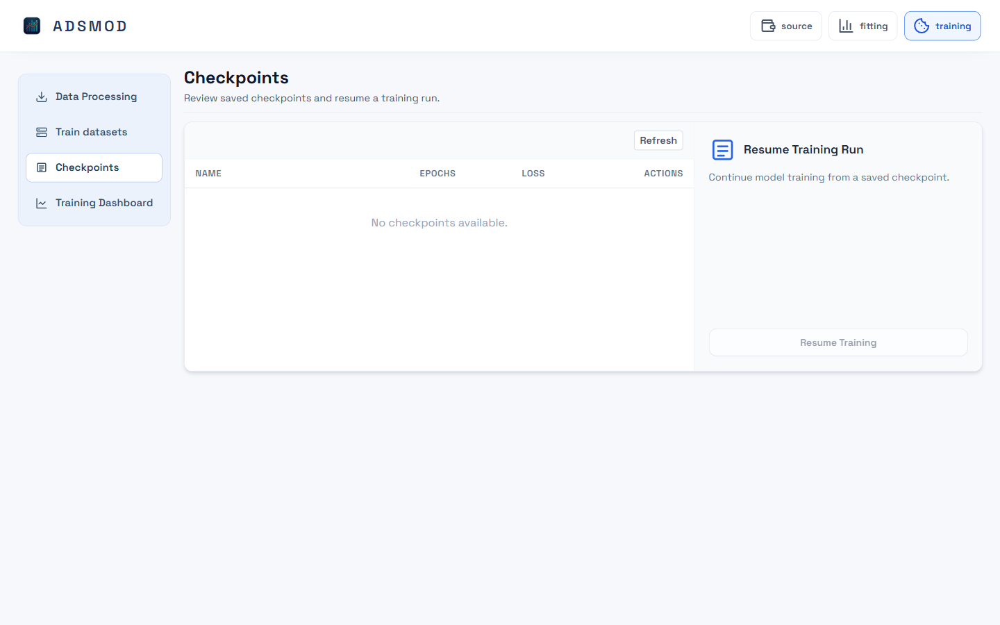

<p align="center"></p>

<h1 align="center">ADSMOD Adsorption Modeling</h1>

<p align="center">A local workspace for preparing adsorption datasets, retrieving reference data, fitting models, and exploring optional machine-learning workflows.</p>

<p align="center">
  <a href="https://github.com/CTCycle/ADSMOD-Adsorption-Modeling/stargazers"></a>
  <a href="https://github.com/CTCycle/ADSMOD-Adsorption-Modeling/commits"></a>
  <a href="https://github.com/CTCycle/ADSMOD-Adsorption-Modeling/releases"></a>
  <a href="LICENSE"></a>
</p>

<p align="center">
  <a href="https://www.python.org/"></a>
  <a href="https://angular.dev/"></a>
  <a href="https://www.microsoft.com/windows"></a>
</p>

## Overview

ADSMOD is a Windows-first local web workspace for preparing adsorption datasets, retrieving public reference data, fitting adsorption models, and exploring optional machine-learning workflows. It combines local CSV, XLS, and XLSX dataset import with normalized public data from NIST, PubChem, and the Crystallography Open Database, including provenance and source health information. The application runs locally with SQLite by default and also supports PostgreSQL for advanced setups. Adsorption models can be compared through asynchronous fitting runs with metrics, logs, cancellation, and saved results, while an optional ML profile supports data preparation, training datasets, checkpoints, and training dashboards. Public-data retrieval depends on the availability of external sources, and numerical fitting compares candidate models without establishing a physical mechanism.

## Key Features

- Import CSV, XLS, and XLSX adsorption datasets, map their columns, validate units and experiment groups, and retain saved datasets.
- Retrieve and organize public adsorption, material, chemical, and structure data with source provenance.
- Manage provider health checks and durable acquisition runs with progress, cancellation, and per-record failure details.
- Compare enabled adsorption models through asynchronous fitting runs, with metrics, logs, cancellation, and saved results.
- Explore stored isotherms through read-only overview and explore dashboards.
- Use the optional ML profile for data preparation, training datasets, checkpoints, and training dashboards.
- Keep the local data and analysis workflow in one browser-based workspace.

## Screenshots

<p align="center">
  <kbd></kbd>
  <kbd></kbd>
</p>
<p align="center"><em>Dataset workspace and fitting workspace.</em></p>

<p align="center">
  <kbd></kbd>
  <kbd></kbd>
</p>
<p align="center"><em>Training dashboard and training datasets.</em></p>

<p align="center">
  <kbd></kbd>
  <kbd></kbd>
</p>
<p align="center"><em>Training data processing and training checkpoints.</em></p>

## Technology Stack

| Layer | Technology |
|---|---|
| Backend | Python 3.14.7, FastAPI 0.128.0 |
| Web client | Angular 21 (TypeScript 5.9) |
| Build tooling | Node.js 22.13.0 |
| Database | SQLite (default), PostgreSQL |
| Launcher | Windows PowerShell with portable Python, uv, and Node.js |

## Installation and Usage

From the repository root in PowerShell, start the launcher:

```powershell
.\start_on_windows.ps1
```

Choose **Launch Application**. On first use, the launcher may download runtimes and packages before opening the local application. The default profile does not enable ML routes; select the ML profile when setting up the optional training workflow.

Manual (from source):

```powershell
cd app/server
uv sync
cd ../client
npm install
```

Then start the backend and client following [Runtime startup](assets/docs/runtime/startup.md).

## Configuration

| Variable | Default | Purpose |
|---|---|---|
| `ADSMOD_STORAGE_ROOT` | `%LOCALAPPDATA%/ADSMOD` | Application data directory |
| `ADSMOD_HOST` | `127.0.0.1` | Backend host |
| `ADSMOD_BACKEND_PORT` | `6045` | Backend port |
| `ADSMOD_FRONTEND_PORT` | `5173` | Angular development server port |
| `ADSMOD_CORS_ORIGINS` | derived | Comma-separated CORS overrides |
| `ADSMOD_CORS_ALLOW_CREDENTIALS` | `true` | Allow credentials for CORS |
| `ADSMOD_CORS_ALLOW_METHODS` | `*` | Allowed CORS methods |
| `ADSMOD_CORS_ALLOW_HEADERS` | `*` | Allowed CORS headers |

Application behavior settings are managed on the console's **Settings** page and stored in the active SQLite or PostgreSQL database. The Database tab stores backend connection details separately in `database.json` under the ADSMOD data directory. `settings/.env` may set the storage root and runtime networking; it contains no database connection values. Host and port changes require an ADSMOD restart. A missing `database.json` selects the default SQLite configuration, and first startup creates the current schema and seeds default settings. Historical database revisions are rejected and must be recreated; startup does not delete existing databases. See [runtime configuration](assets/docs/runtime/configuration.md) for field mapping and switching limits.

## Documentation

- [Runtime startup](assets/docs/runtime/startup.md)
- [Runtime configuration](assets/docs/runtime/configuration.md)

## Limitations

- Public-data retrieval depends on the availability of external sources such as NIST, PubChem, and COD.
- Numerical fitting compares candidate models; it does not establish a physical mechanism.
- Windows-first workflow; no mobile layout is provided.

## Contributing

Contributions are welcome. Open an issue or pull request with a clear description of the change and its motivation.

## License

Licensed under the MIT License. See [LICENSE](LICENSE).
