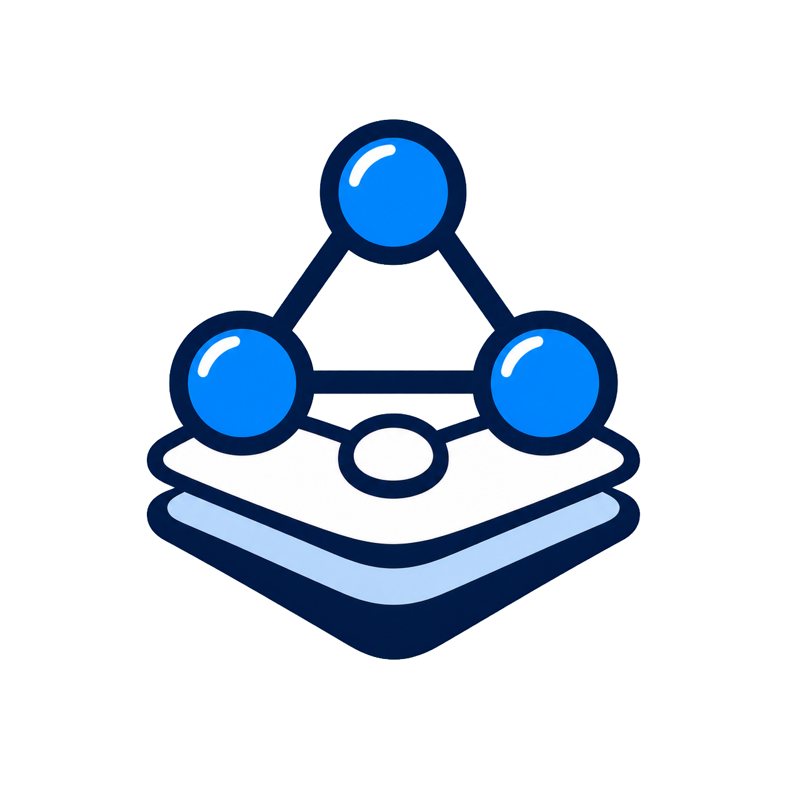
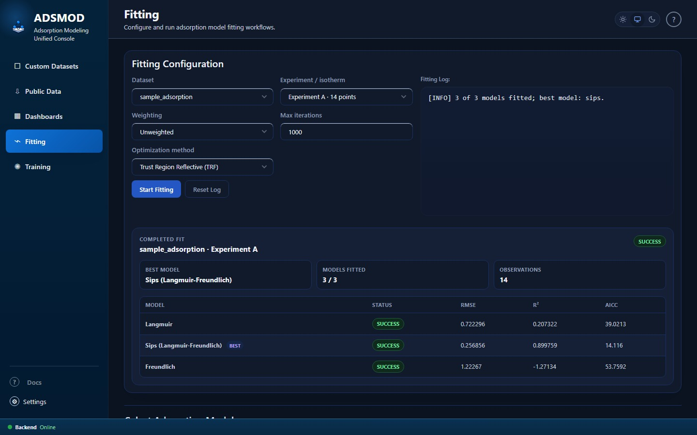
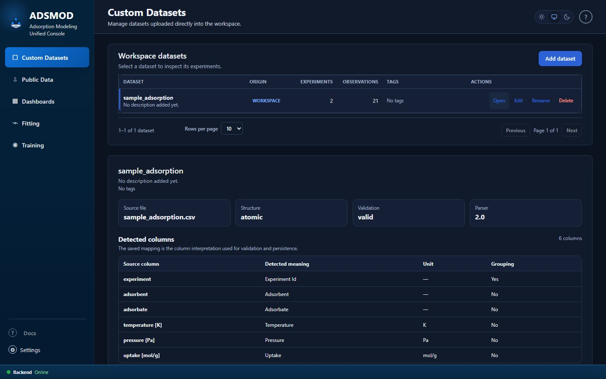

<p align="center"></p>

<h1 align="center">ADSMOD</h1>

<p align="center">A local workspace for adsorption data, isotherm fitting, and analysis.</p>

<p align="center">
  <a href="https://github.com/CTCycle/ADSMOD-Adsorption-Modeling/stargazers"></a>
  <a href="https://github.com/CTCycle/ADSMOD-Adsorption-Modeling/commits"></a>
</p>

<p align="center">
  <a href="https://github.com/CTCycle/ADSMOD-Adsorption-Modeling/releases"></a>
  <a href="https://github.com/CTCycle/ADSMOD-Adsorption-Modeling/actions/workflows/ci.yml?query=branch%3Adevelop"></a>
  <a href="LICENSE"></a>
</p>

<p align="center">
  <a href="https://www.python.org/"></a>
  <a href="https://angular.dev/"></a>
  <a href="https://www.microsoft.com/windows"></a>
</p>

<p align="center">
  <a href="#capabilities">Capabilities</a> ·
  <a href="#start-adsmod">Start ADSMOD</a> ·
  <a href="#configuration">Configuration</a> ·
  <a href="#development">Development</a> ·
  <a href="assets/docs/project_index.md">Documentation</a>
</p>

<p align="center"></p>

<p align="center"><em>A completed fit of the included sample isotherm, with three models selected for this run.</em></p>

ADSMOD is a local web application for organizing adsorption measurements, fitting isotherm models, and exploring stored results. SQLite is the default database; PostgreSQL is also supported.

## Capabilities

| Workspace | What it does |
| --- | --- |
| **Custom datasets** | Import and validate CSV, XLS, and XLSX files. |
| **Public data** | Work with NIST, PubChem, and COD records. |
| **Fitting** | Select from nine built-in isotherm models. |
| **Dashboards** | Filter and visualize stored measurements. |
| **Training** *(optional ML profile)* | Prepare data and manage training runs and checkpoints. |

## Start ADSMOD

The supported local setup is Windows with PowerShell 7. From a PowerShell 7 window:

```powershell
git clone https://github.com/CTCycle/ADSMOD-Adsorption-Modeling.git
Set-Location ADSMOD-Adsorption-Modeling
.\start_on_windows.ps1
```

Choose the application launch option in the menu. On first use, the launcher downloads its pinned Python, `uv`, and Node.js runtimes, installs the selected dependency profile, and builds the web client. This setup can take several minutes. Keep the console open while using ADSMOD; press **Ctrl+C** there to stop it.

The base profile includes the dataset, public data, fitting, and dashboard workspaces. Choose the optional ML profile during setup to enable training and checkpoint workflows. Initial setup and public-provider requests require network access.

## Workflows

### Import and inspect a dataset

Add a CSV, XLS, or XLSX file, review the detected structure, map columns and units, then validate the experiment series before saving. Saved datasets retain their source mapping and can be used in fitting and dashboards.

<p align="center"></p>

<p align="center"><em>The saved sample contains two experiments and 21 observations. Screenshots use the repository's <a href="app/tests/fixtures/sample_adsorption.csv">sample adsorption file</a>.</em></p>

### Fit isotherm models

Choose a dataset and experiment, select models, and set the optimizer, weighting, and iteration limit. The built-in models are Langmuir, Sips, Freundlich, Temkin, Toth, Dubinin-Radushkevich, Dual-Site Langmuir, Redlich-Peterson, and Jovanovic. Results report each model's status and metrics; ADSMOD selects the best fit using the configured metric.

A numerical fit describes how a model follows the observations. It does not establish an adsorption mechanism.

### Explore stored measurements

The overview summarizes the database. Explore filters by source, pressure basis, temperature, material, adsorbate, or dataset, then plots isotherm curves, uptake at a selected pressure against temperature, or a value distribution. Views can be linked with their current filters.

### Retrieve public records

The Public Data workspace can acquire adsorption records from NIST, resolve chemical identities and properties through PubChem, and search the Crystallography Open Database (COD) for structures. Provider availability varies; local records remain available when a provider cannot be reached.

### Train models (optional)

The ML profile adds data processing, training datasets, training jobs, checkpoints, and a training dashboard. Training is not required for dataset import, fitting, or dashboards.

## Configuration

On Windows, ADSMOD stores its database, logs, and training artifacts under `%LOCALAPPDATA%\ADSMOD` by default. Set `ADSMOD_STORAGE_ROOT` in `settings/.env` or the process environment to use another directory. SQLite is selected by default; PostgreSQL connection settings are managed in **Settings → Database**.

See [runtime configuration](assets/docs/runtime/configuration.md) for database and networking options, or [troubleshooting](assets/docs/operations/troubleshooting.md) for common startup issues.

## Development

The backend uses Python 3.14+ and FastAPI; the client uses Angular 21. The launcher provisions the pinned runtimes for normal use. For manual startup and frontend development, see the [startup guide](assets/docs/runtime/startup.md). The [quality guide](assets/docs/coding/quality_gates.md) describes the project checks.

The [project documentation index](assets/docs/project_index.md) links to architecture, API, runtime, UI, and workflow documentation.

## Contributing

Issues and focused pull requests are welcome. Please follow the conventions in the [quality guide](assets/docs/coding/quality_gates.md).

## License

[MIT](LICENSE)
