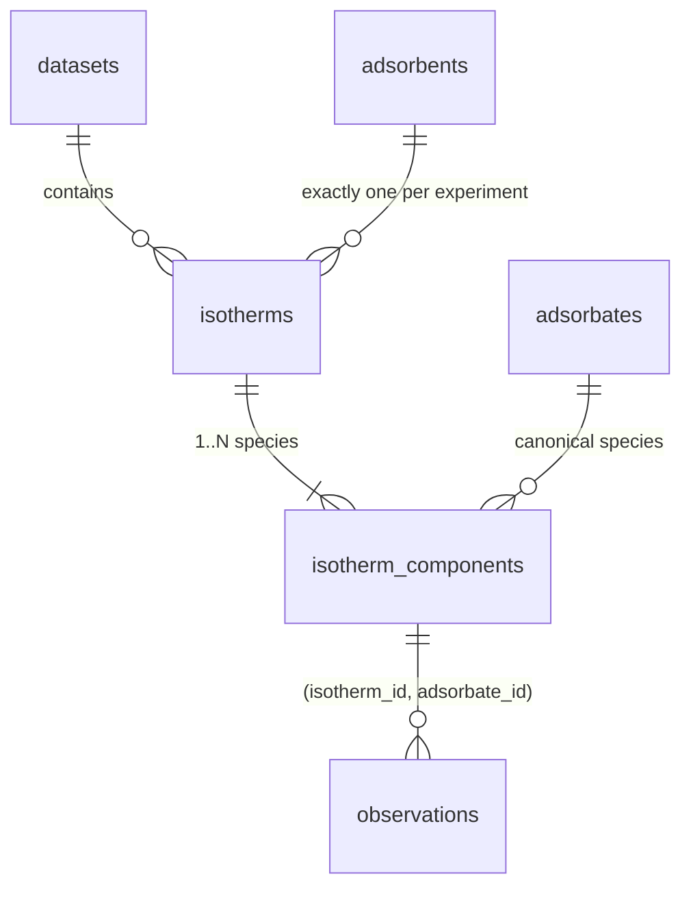

# Persistence and packages

Last updated: 2026-11-10

## Backend package

`app/server/pyproject.toml` and `app/server/uv.lock` define one Hatch package
named `adsmod-backend-workspace`. The package is rooted at `app/server`, with
the `ml` extra selecting the optional learning dependencies. The launcher and
CI install this package and use its lockfile.

## Core persistence

Core owns the active database and its Alembic baseline under
`app/server/migrations`. SQLite and PostgreSQL share the same schema. The
history is one root revision, `20261110_unified_baseline`, which creates the
whole schema including the unified adsorption tables; future revisions chain
linearly from it. Startup upgrades an empty database to the head and accepts
only that head; it never infers or silently adopts an unknown schema. Databases
stamped with any earlier revision (including the retired
`20261021_current_schema` … `20261110_species_identity` chain) fail closed and
must be recreated. Startup
does not drop or recreate them. The current schema includes
the `application_settings` singleton and immutable `training_snapshots` and
`training_snapshot_rows` tables.

`DatabaseManager` is the stable owner of the active engine, session factory,
and transaction boundary. Repositories and services keep that manager rather
than retaining independent pools. The Database Settings endpoint verifies and
migrates a candidate before draining HTTP requests and session leases, then
adopts its engine and reloads the candidate database's settings. Active jobs
and public-data sync runs block switching; failed activation restores the
previous manager and configuration.

Database connection settings are stored in `database.json` under the
application data root, independent of either backend. The versioned file is
validated before the database is opened and replaced atomically. Passwords
use Windows DPAPI on Windows; elsewhere the file is restricted to mode 0600.
Application settings and operational records have one authority: the active
database. Switching databases never copies settings or operational data. A
missing `database.json` selects the current default SQLite configuration;
successful fresh initialization seeds typed settings before persisting the file.
Retired environment variables and older JSON settings files are not imported.

SQLite keeps foreign-key enforcement enabled during schema initialization and
must pass `PRAGMA foreign_key_check` before commit.

SQLite transactions serialize writes within the single backend process to
avoid lock-upgrade collisions when independent public-data runs are queued or
updated concurrently. PostgreSQL continues to use database-managed transaction
concurrency.

## Fitting sessions

`fitting_sessions` (one per dataset-level run, with a `configuration` JSON
snapshot of effective bounds, overrides, and experiment input hashes) owns
`fitting_session_models`, `fit_results` (`session_id`; `isotherm_id` is SET NULL
and `isotherm_name` is kept so results survive experiment deletion), and
`fit_parameters`. `adsorption_model_settings` holds one row per model
(`model_key`, `enabled`, `parameter_bounds` JSON in canonical units,
`updated_at`) and supplies the global solver bounds; the former
`application_settings.fitting_default_parameter_*` columns were dropped.
Older single-experiment `fitting_runs` were discarded when sessions were
introduced. The dataset delete-impact field is `fitting_session_count`. A fit
series is one species of one experiment; the fitting service rejects
experiments with several species at the capability level because every model
in the catalog describes pure-species adsorption. For the same reason (the
models describe equilibrium adsorption), `fitting_series` fits only the
adsorption branch; desorption points are never part of a fit or its input hash.
ML snapshot rows likewise come from the adsorption branch only, and the snapshot
metadata records `branch: adsorption`.

## ML artifacts

ML does not open the operational database. It receives snapshots through the
in-process `TrainingDataAccess` contract, checks the content hash, and keeps its
training manifest and checkpoints under the configured storage root. This
prevents ORM changes from becoming an implicit ML API.

## Adsorption data model

There is one adsorption model, independent of the number of species. Adsorption
data is stored as dataset → experiment → species → measurement:

- `datasets` is a collection of one or more experiments (`created_at`, and
  `updated_at`, exposed as `last_update`, which is bumped on every saved edit
  and whenever experiments are appended).
- `isotherms` is the experiment table: one dataset, exactly one adsorbent
  (`adsorbent_id`, RESTRICT), exactly one temperature (`temperature_k`;
  measurements carry none, and an upload whose rows disagree on temperature
  within one experiment is rejected), a pressure basis, and an optional
  saturation pressure. `edited_at` records the last local edit; NIST
  re-download restores edited experiments only when explicitly confirmed.
  `provenance.duplicates` records whether replicates were averaged at import.
- `isotherm_components` links an experiment to its species, primary key
  `(isotherm_id, adsorbate_id)`, with a unique `position` and the received
  `source_name`. The species count is derived from these rows and never
  selects a different structure.
- `observations` is the single measurement table: one row per species, branch
  and pressure. `branch` is `adsorption` or `desorption` (NOT NULL, default
  `adsorption`, `ck_observations_branch`), so a hysteresis loop stays in the
  same long format with no per-branch table. Rows hold source values and
  units next to the canonical pressure
  (`pressure_canonical`, Pa or p/p₀) and uptake (`uptake_mol_kg`), an optional
  uncertainty, and an optional per-point gas-phase mole fraction
  (`gas_mole_fraction`). A composite foreign key to
  `isotherm_components(isotherm_id, adsorbate_id)` (ON DELETE/UPDATE CASCADE)
  guarantees that a measurement's species belongs to its experiment.

Measurement identity is `(isotherm_id, adsorbate_id, branch, pressure_key)`,
enforced by `uq_observations_identity`; `ix_observations_species_pressure`
covers `(isotherm_id, adsorbate_id, branch, pressure_canonical)`.
`pressure_key` quantizes the canonical pressure (1 µPa for Pa, 1e-9 for p/p₀)
through `domain.canonical.pressure_key`, the same helper the importer uses, so
duplicate detection and the constraint never disagree. One pressure may
therefore hold one adsorption and one desorption uptake. Two uptakes on the
same branch at the same pressure (a vertical step or a replicate) are
rejected, or averaged at import into one stored row whose
`extra_metadata.replicates` keeps the count, source rows, and values; a
conflicting insert raises instead of overwriting.

Sources that label branches (an upload `branch` column: adsorption/desorption,
ads/des or a/d, case-insensitive) pass them through. Sources without labels
(NIST, uploads without the column) go through `domain.canonical.assign_branches`,
which works per species in source order: points up to the first point at the
highest pressure (inclusive) are adsorption, except that a series starting at
its maximum and then falling is a desorption branch throughout; later points
must not rise in
pressure, a falling point is desorption, and a point at its predecessor's
pressure joins that point's branch (so a vertical step stays a duplicate). A
pressure rise after the desorption branch started raises `ambiguous_branch`
instead of guessing. `provenance.branch_assignment` records `explicit` or
`inferred`.

Pressure basis (`isotherms.pressure_basis`) defines the canonical pressure
column:

| Basis | Canonical pressure | Notes |
|---|---|---|
| `absolute` | System total pressure in Pa, shared by every species at a point | Partial pressure is `gas_mole_fraction × pressure`; with one species total equals partial |
| `partial` | Each species' own partial pressure in Pa | Only when the source states partial pressures; never derived from a total |
| `relative` | p/p₀ (unit `1`) | Single-species experiments only, because p₀ is per species |

Every source goes through `domain.canonical.normalize_experiment` (a
`CanonicalExperiment` model) before persistence; `write_experiment_content`
re-applies it as a guard. It validates declared species, units per basis, at
least two distinct pressures per species on one branch (so a desorption-only
series is stored; it has no adsorption branch to fit or train on), gas fractions (≤ 1 per
branch and pressure, 1 or empty for one species), and duplicates per
(species, branch, pressure). Upload files with one uptake
column per species are melted to long rows during import, so no per-species
column is ever stored.

`adsorbents` and `adsorbates` are reusable across datasets; deleting a dataset
cascades to its experiments, measurements, and fitting sessions but never removes
materials or species, and a material or species cannot be deleted while an
experiment references it. Edits overwrite stored values in one transaction
(`DatasetEditRepository.apply`); there is no version history. Edited source
values are re-converted with the importer's `UnitCatalog`, so canonical values
follow the same unit rules as imports.

